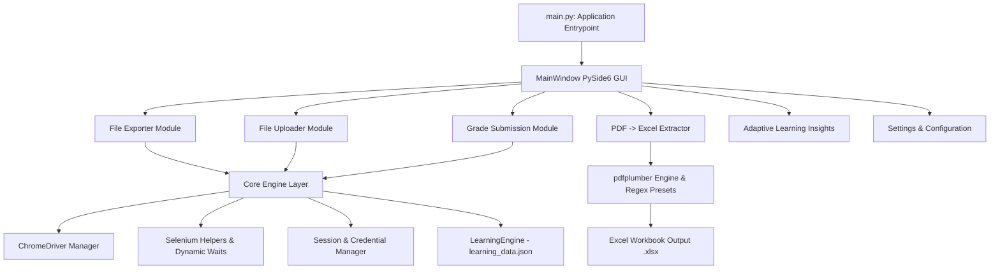

# 🚀 Unified System Automation Suite

A high-performance, modular desktop automation platform designed to streamline student information system workflows (PCR Educator, Orbund, MyPath) and high-volume document processing.

Built with Python, PySide6 (Qt for Python), Selenium, and `pdfplumber`, the suite integrates web scraping, batch file uploads, grade posting, PDF data extraction, and an adaptive machine-learning engine into a modern dark-themed Qt interface.

---

## 📑 Table of Contents
- [Overview](#-overview)
- [Key Features](#-key-features)
- [System Architecture](#-system-architecture)
- [Directory Structure](#-directory-structure)
- [Installation & Setup](#-installation--setup)
- [Configuration & File Formats](#-configuration--file-formats)
  - [1. Credentials File (`credentials.txt`)](#1-credentials-file-credentialstxt)
  - [2. Record Links CSV](#2-record-links-csv)
  - [3. Grade Submission CSV](#3-grade-submission-csv)
  - [4. Source Folder Structure for File Uploader](#4-source-folder-structure-for-file-uploader)
- [How to Use the Modules](#-how-to-use-the-modules)
  - [📥 Module 1: File Exporter](#-module-1-file-exporter)
  - [📤 Module 2: File Uploader](#-module-2-file-uploader)
  - [🎓 Module 3: Grade Submission](#-module-3-grade-submission)
  - [📄 Module 4: PDF → Excel Extractor](#-module-4-pdf--excel-extractor)
  - [🧠 Module 5: Adaptive Learning & Self-Optimization](#-module-5-adaptive-learning--self-optimization)
- [Building the Windows Executable](#-building-the-windows-executable)
- [Troubleshooting & Best Practices](#-troubleshooting--best-practices)

---

## 🌟 Overview

Educational institutions and administrative offices often handle thousands of manual portal interactions every term: downloading student files, uploading enrollment verifications, entering final course grades, and manually reading transcript PDFs.

The **Unified System Automation Suite** replaces these repetitive manual tasks with robust, resilient automation engines:
- **Resilient Automation**: Automatically retries flaky elements, recovers from unexpected modals, and bypasses stale DOM elements.
- **Adaptive Learning**: Remembers successful XPath locators, page latencies, and student layout variations across runs.
- **Auditable & Safe**: Produces row-by-row execution log CSVs, timestamped debug logs, and interactive disk file verification.

---

## ⚡ Key Features

| Feature | Description |
| :--- | :--- |
| **📥 Web File Exporter** | Automates downloading transcripts, action files, and documents from student profile portals with auto-detection or preset scrapers. |
| **📤 Batch File Uploader** | Navigates student profile folders and batch-uploads categorized local files directly into portal document systems. |
| **🎓 Dynamic Grade Submission** | Submits final grade flags, dates, and scores with automatic detection between score input fields and grade dropdowns. |
| **📄 PDF → Excel Extractor** | Parses folders of identically formatted PDFs (transcripts, schedules, ledgers) into structured `.xlsx` workbooks using JSON recipes. |
| **🧠 Adaptive Learning Engine** | Learns fast XPaths, domain quirks (such as DevTools requirements), and student profile placements to speed up subsequent runs. |
| **🖥️ Modern Desktop GUI** | Collapsible navigation, dark mode, real-time KPI metrics, execution logs, and interactive visual PDF configuration preview. |

---

## 🏗️ System Architecture



---

## 📂 Directory Structure

```
unified_dashboard/
├── main.py                     # GUI launcher and global crash handler (PySide6)
├── main_qt.py                  # Direct launcher alias
├── requirements.txt            # Python dependencies
├── settings.json               # Application runtime settings
├── learning_data.json          # Persisted machine learning & XPath cache
├── build.spec                  # PyInstaller specification for single-file packaging
├── build_windows.bat           # One-click Windows build script
├── runtime_hook.py             # PyInstaller runtime hook for module resolution
│
├── core/                       # Shared platform utilities
│   ├── chrome_driver.py        # Chrome WebDriver lifecycle & DevTools initialization
│   ├── learning_system.py      # Self-optimizing XPath & domain learning engine
│   ├── logger.py               # Centralized logging configuration
│   ├── paths.py                # Cross-platform persistent path management
│   ├── selenium_helpers.py     # Resilient wait, retry, click, and input helpers
│   ├── session_manager.py      # User sessions & credential parsing
│   ├── settings_manager.py     # Configuration load/save handlers
│   └── utils.py                # CSV validation, file sanitization, and helpers
│
├── modules/                    # Background automation engines
│   ├── file_exporter.py        # Document scraping & export logic
│   ├── file_uploader.py        # Automated document folder uploader
│   ├── grade_submission.py     # Final grade & score submission engine
│   └── pdf_extractor.py        # Batch PDF parsing into Excel
│
├── pdf_extractor_configs/      # Reusable JSON recipes for PDF extraction
│   ├── BCC Trans.json
│   ├── Example - Bayamon Transcript.json
│   ├── student_ledger.json
│   ├── student_schedule.json
│   └── student_transcript.json
│
└── ui_qt/                      # Presentation layer (Modern PySide6 Qt Interface)
    ├── components/             # Reusable UI widgets (BaseToolWidget, KPIs, Badges, Charts)
    │   ├── badge.py            # Status badges & KPI metric cards
    │   ├── base_tool_widget.py # Unified tool runner layout & multi-task queue table
    │   ├── inter_task_dialog.py# Inter-task confirmation dialogs
    │   └── time_series_graph.py# Telemetry graph widget
    ├── theme.py                # Modern dark palette, styling tokens & QSS sheets
    ├── main_window.py          # Primary shell with collapsible sidebar & navigation
    └── views/                  # Dedicated automation tool views
        ├── documentation_view.py
        ├── file_exporter_view.py
        ├── file_uploader_view.py
        ├── grade_view.py
        ├── home_view.py
        ├── learning_view.py
        ├── pdf_extractor_view.py
        ├── pdf_review_view.py
        └── settings_view.py
```

---

## 💻 Installation & Setup

### 1. Prerequisites
- **Python 3.10+** (Python 3.10 - 3.14 supported).
- **Google Chrome** installed on your system.

### 2. Clone or Download
Clone the repository to your local machine:
```bash
git clone https://github.com/arman-hossain-git/automation.git
cd automation
```

### 3. Create a Virtual Environment (Recommended)
```bash
python -m venv .venv

# On Windows (PowerShell):
.venv\Scripts\Activate.ps1

# On Windows (Command Prompt):
.venv\Scripts\activate.bat
```

### 4. Install Dependencies
```bash
pip install -r requirements.txt
```

### 5. Launch the Dashboard
```bash
python main.py
```

---

## ⚙️ Configuration & File Formats

### 1. Credentials File (`credentials.txt`)
Store your portal login credentials in a plain text file formatted with `key=value` pairs:

```ini
# ==================================================================
# Credentials Configuration File (.txt)
# ==================================================================

# REQUIRED FIELDS:
username=your_portal_username
password=your_portal_password
login_url=https://portal.example.com/login.aspx

# OPTIONAL: Custom XPath Overrides (leave blank for automatic detection)
username_xpath=
password_xpath=
login_btn_xpath=
role=
```

---

### 2. Record Links CSV
Used by **File Exporter** and **File Uploader** to map student records to their portal URLs:

```csv
studentId,link
1001,https://portal.example.com/StudentProfile.aspx?id=1001
1002,https://portal.example.com/StudentProfile.aspx?id=1002
1003,https://portal.example.com/StudentProfile.aspx?id=1003
```
*Note: Column names are case-insensitive (`studentId`, `id`, `student` and `link`, `url` are automatically accepted).*

---

### 3. Grade Submission CSV
Used by **Grade Submission** to submit final marks:

```csv
studentId,link,finalGradeReceivedDate,score
1001,https://portal.example.com/StudentProfile.aspx?id=1001,2026-07-31,95
1002,https://portal.example.com/StudentProfile.aspx?id=1002,2026-07-31,A+
1003,https://portal.example.com/StudentProfile.aspx?id=1003,2026-07-31,88
```

---

### 4. Source Folder Structure for File Uploader
Organize the local files you want to upload by **Student ID** subfolders matching the CSV:

```
Source_Directory/
├── 1001/                        <-- Matches studentId in CSV
│   ├── Admissions Inquiry/      <-- Folder category on the portal
│   │   ├── Application.pdf
│   │   └── Transcript.pdf
│   └── Profile Documents/
│       └── ID_Card.png
├── 1002/
│   └── Verification_Form.pdf   <-- Uploaded to Root if no subfolder
└── 1003/
    └── Admissions Inquiry/
        └── Resume.pdf
```

---

## 📖 How to Use the Modules

### 📥 Module 1: File Exporter
Scrapes and exports documents from student profiles into a structured local directory.
1. Open **File Exporter** from the left navigation bar.
2. Select your `credentials.txt` and `Record Links CSV`.
3. Select a **Save Files Directory** where downloaded files should be stored.
4. Select an **Exporter Preset**:
   - `Dynamic Scraper (Auto-detect)`: Scrapes tables and links on any portal.
   - `PCR Action Files (Admissions)`: Downloads admissions action files.
   - `PCR Dashboard Files (Main)`: Scrapes files directly from student document dashboards.
   - `MyPath Document Generator`: Automates dropdown selections, clicking "Generate", and capturing PDF preview modals.
5. Click **▶ Start Automation**.
6. When finished, click **✓ Verify Results** to cross-examine downloaded files against `automation_execution_log.csv`.

---

### 📤 Module 2: File Uploader
Uploads local documents into portal document management folders (such as *Files & Documents*).
1. Open **File Uploader**.
2. Select your `credentials.txt` and `Student Links CSV`.
3. Choose your **Source Directory** containing the student ID folders.
4. Choose your **Target Folder**:
   - `(None)`: Uploads to the root of *Files & Documents*.
   - Specific Category: e.g., `Admissions Inquiry`, `Students Inquiry`.
   - Custom Subfolder: Specify a new folder name to auto-create and populate.
5. Click **▶ Start Automation**.

---

### 🎓 Module 3: Grade Submission
Automates posting student completion statuses and final grades.
1. Open **Grade Submission**.
2. Select your `credentials.txt` and `Grade Links CSV`.
3. Click **▶ Start Automation**.
4. The engine will:
   - Search across Regular, Waiting, or Withdrawn student lists.
   - Open the Edit Status modal.
   - Mark **Final Grade Received** as `'Yes'` and set the date.
   - Detect whether the record uses a free-text **Adjust Score** field or a **Grade** dropdown and fill it accordingly.

---

### 📄 Module 4: PDF → Excel Extractor
Converts batches of unstructured or semi-structured PDF documents into a clean Excel spreadsheet.
1. Put all PDFs sharing the same layout into a single folder.
2. Open **PDF → Excel Extractor**.
3. Under **Setup & Configuration**:
   - Select the **Source Folder** containing the PDFs.
   - Select the **Output Excel File** destination (`.xlsx`).
4. Load an **Extraction Config Preset** (e.g., `BCC Trans`, `student_ledger`, or create a custom preset).
5. Switch to **🔍 Visual Config Verify** to test the recipe against a real PDF:
   - Preview extracted fields and table rows in real time.
   - Calibrate regex anchors and bounding boxes.
6. Return to setup and click **▶ Start Automation**.

---

### 🧠 Module 5: Adaptive Learning & Self-Optimization
The suite learns as it runs to become faster and more reliable:
- **XPath Success Weights**: Ranks selectors based on historical speed and success rates.
- **Domain Latencies**: Tracks page load speeds per domain to calibrate intelligent wait times.
- **DevTools Prediction**: Detects if specific web portals require Chrome DevTools open to render certain components and applies this setting automatically.
- Open **Learning Insights** to view current speed metrics, success rates, and time-series performance graphs.

---

## 📦 Building the Windows Executable

To compile the entire suite into a standalone Windows executable (`UnifiedDashboard.exe`) that runs on any Windows machine without requiring Python:

Run the included batch script:
```cmd
build_windows.bat
```

Or invoke PyInstaller manually:
```cmd
pyinstaller build.spec
```

The standalone executable and bundled configuration presets will be generated inside the `dist/` directory.

---

## 🛠️ Troubleshooting & Best Practices

- **Browser Closes Immediately**: Check `settings.json` or open the Settings tab. Ensure Chrome is up to date and that antivirus software isn't blocking ChromeDriver.
- **Portal Displays Pop-up Modals**: The core helper `close_unexpected_modals()` automatically detects and closes common alert dialogs, session extensions, and banner modals.
- **DevTools Requirement**: Some portal grids require active Chrome DevTools to disable background throttling. Enable **Auto-open DevTools** in Settings if items fail to load in background tabs.
- **Execution Logs**: Detailed logs are always written to:
  - `automation_debug.log`: Detailed stack traces and network events.
  - `automation_execution_log.csv`: Status summary per student ID.
